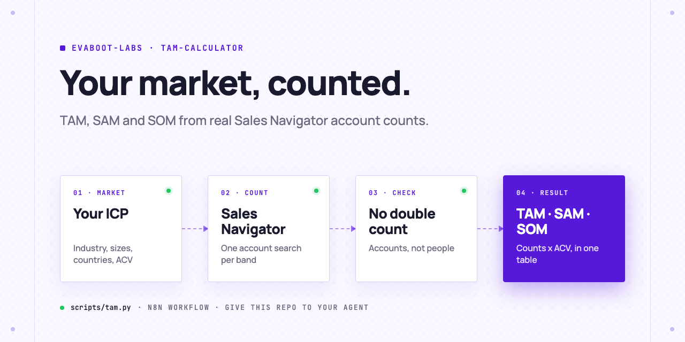
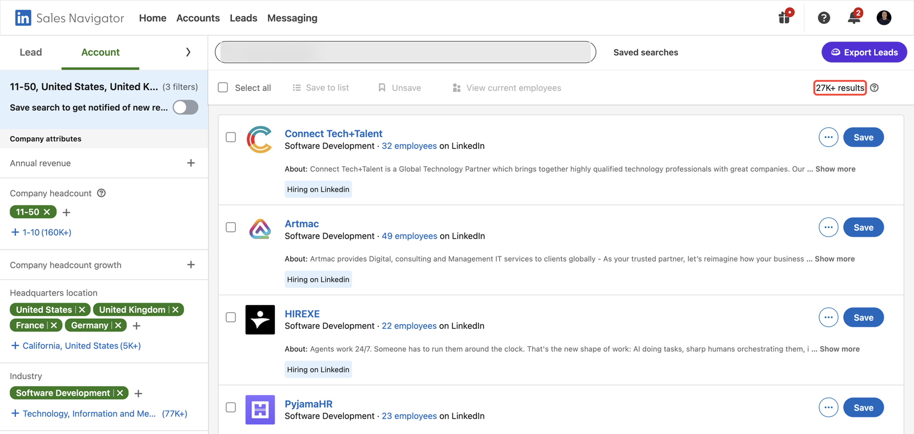
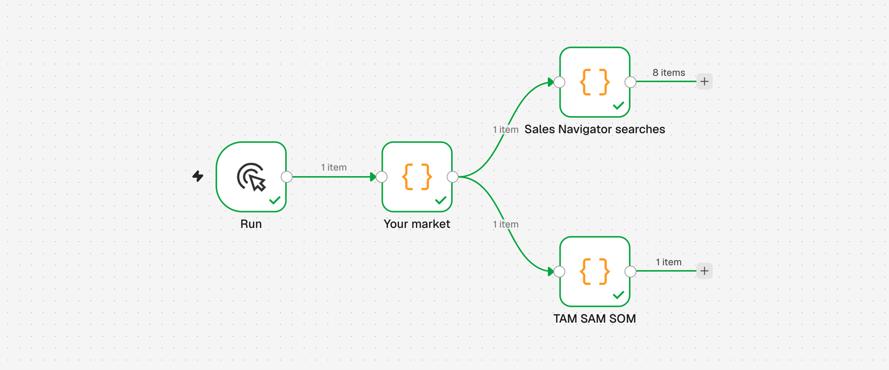
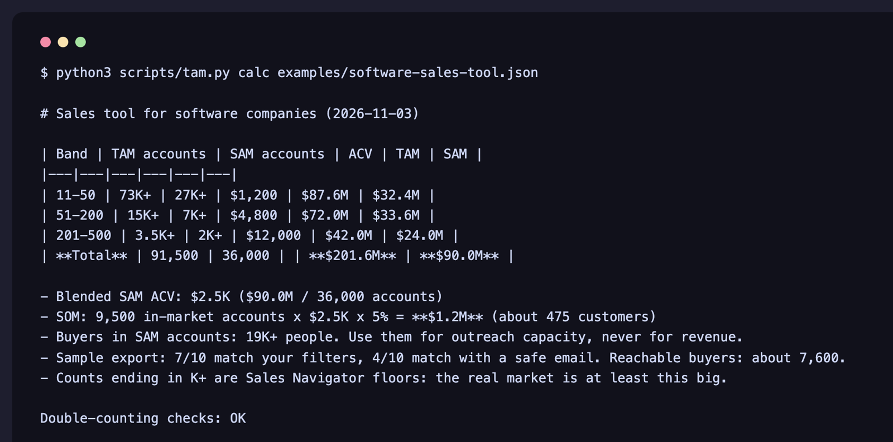

<picture>
  <source media="(prefers-color-scheme: dark)" srcset=".github/assets/banner-dark.png">
  
</picture>

# TAM calculator

Size your market bottom-up from LinkedIn Sales Navigator: one account search per company-size band, the same searches in the countries you sell to, one in-market filter, then each count times your annual contract value (ACV). No double counting, no analyst report.

[](AGENTS.md)
[](https://evaboot.com/mcp)
[](LICENSE)

## Set it up in one prompt

Paste this into Claude Code, Codex or Cursor:

```text
Clone https://github.com/evaboot-labs/tam-calculator, read AGENTS.md and follow the skill. Calculate the TAM, SAM and SOM of my product: we sell to software companies with 11 to 500 employees in the US and the UK.
```

<details>
<summary>Or install the skill</summary>

Claude Code:

```text
/plugin marketplace add evaboot-labs/tam-calculator
/plugin install tam-calculator@evaboot-labs-tam-calculator
```

Codex, Cursor and other agents:

```bash
npx skills add evaboot-labs/tam-calculator
```

</details>

## How it works

**1. One account search per band.** Company-size bands never overlap, so their counts add up. The SAM searches add your countries; the SOM search adds an in-market filter.



**2. Script or n8n.** `scripts/tam.py` and the n8n workflow build the same searches and run the same math.



**3. One table.** Counts times ACV per band, a blended ACV, the SOM, and a double-counting check.



## What you need

- A Sales Navigator seat to read the counts.
- Python 3 (standard library only), or n8n.
- Your ACV per company-size band, from your own deals or price list.
- Cost: reading counts is free. The optional reachability sample costs 10 [Evaboot](https://dash.evaboot.com/accounts/signup/?last_click_origin=tam-calculator-repo) credits.

## Go further

| Page | For |
|---|---|
| [docs/counting-rules.md](docs/counting-rules.md) | The four rules that stop double counting |
| [docs/connect-your-agent.md](docs/connect-your-agent.md) | The Evaboot connector or key, by hand, for each agent |
| [docs/n8n.md](docs/n8n.md) | The same calculator in n8n |

---

Agents: start at [AGENTS.md](AGENTS.md) · Built by [Evaboot](https://evaboot.com) · More workflows at [github.com/evaboot-labs](https://github.com/evaboot-labs) · [MIT license](LICENSE)
